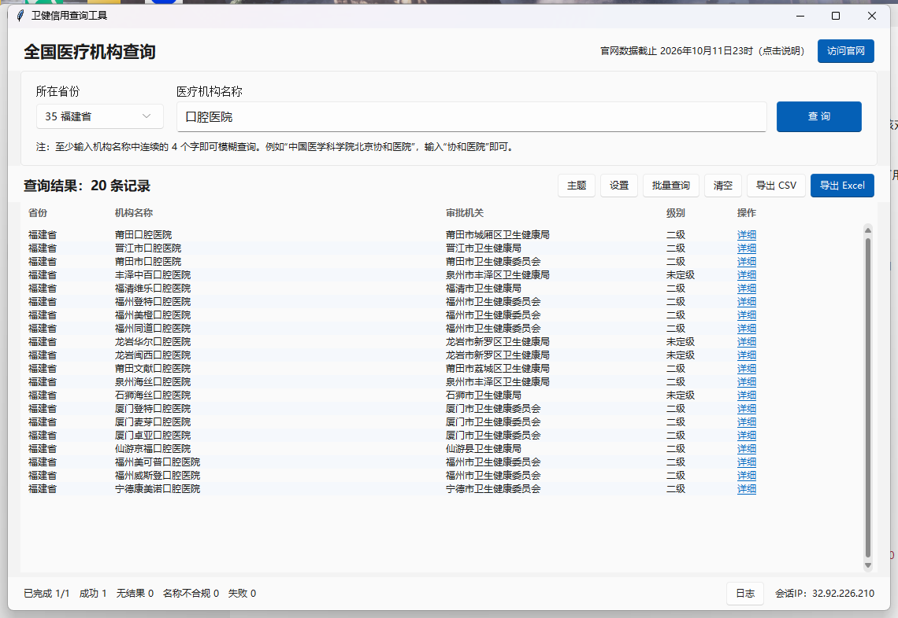
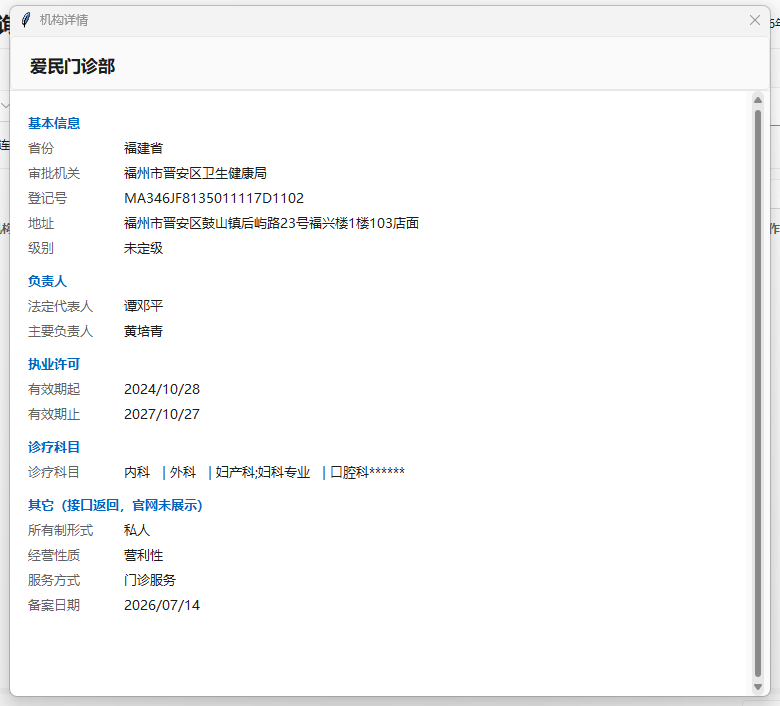
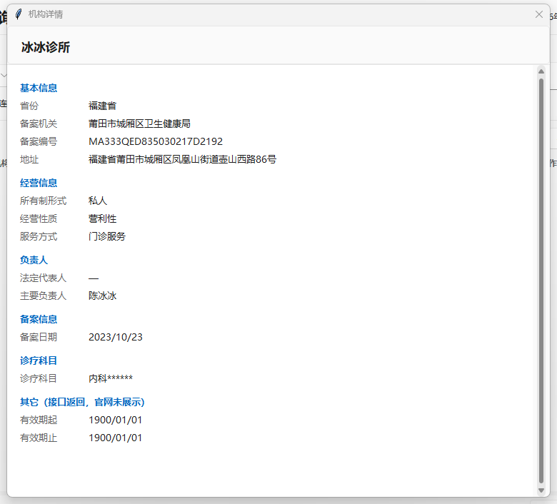
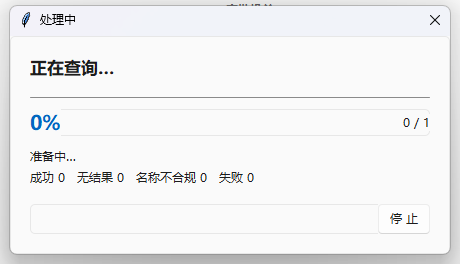
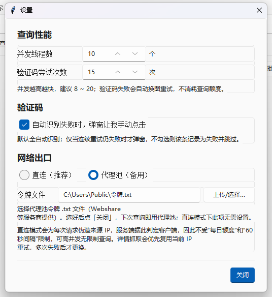
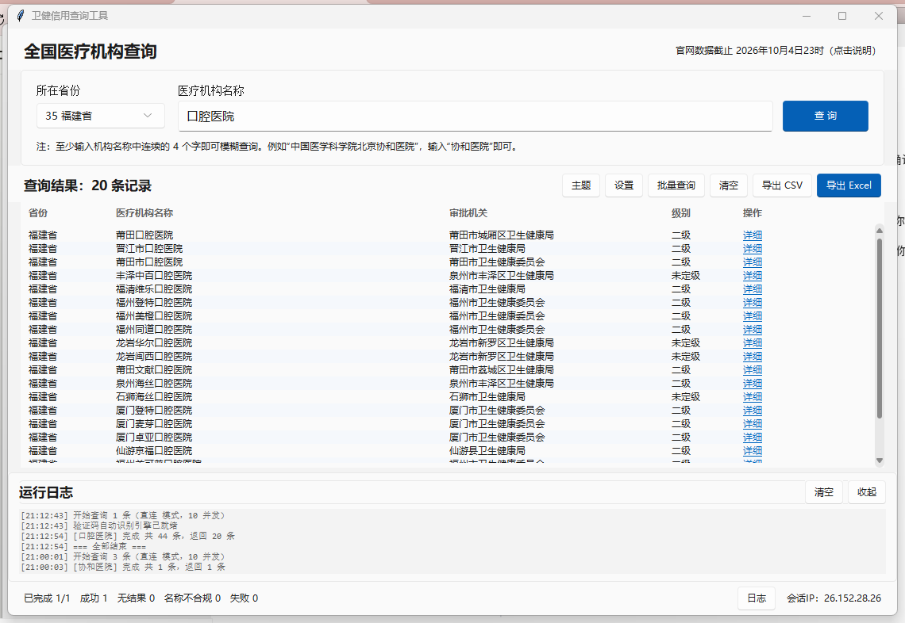

# 全国医疗机构查询工具


> 国家卫生健康委「全国医疗机构查询」官网的桌面客户端 —— 图形界面 + 命令行。
> 自动识别点选验证码，支持批量查询与机构详情导出，**单文件绿色版**，
> Windows 7 SP1 ~ 11（64 位）通用。



## 下载

**最新版** → [Releases](https://github.com/Maiusless/nhc-unit-query/releases/latest)

| Release 资产 | 大小 | 说明 |
|---|---|---|
| `nhc-query-tool.exe` | 136 MB | **图形界面主程序，只需要这一个**（即本地构建的 `卫健查询工具.exe`） |
| `nhc-cli.exe` | 136 MB | 命令行版（批量脚本 / 诊断），可选 |
| `nhc-query-tool-win7-folder.zip` | 130 MB | Win7 兜底：单文件版在个别 Win7 环境起不来时用，解压后双击里面的 exe |

> GitHub 的 Release 资产名**不支持中文**，因此资产用英文名，程序与本地构建的完全一致。
> 下载后放到任意目录双击即可，**无需安装任何东西，也无需管理员权限**。

> 首次运行若弹「Windows 已保护你的电脑」，点「更多信息」→「仍要运行」即可
> （未购买代码签名证书）；部分杀毒软件会误报，加入信任即可。

## 功能

- **实时联网查询**：按省份 + 机构名称模糊查询（≥ 4 个连续汉字），与官网数据完全一致，无需维护
- **验证码全自动**：点选验证码自动识别（ddddocr + ONNX），失败自动换图重试，兜底可人工点选
- **结果可复制**：表格可直接拖动选中 / `Ctrl+C` / `Ctrl+A`；「详细」为蓝色链接，单击查看机构详情
- **详情与官网逐项对齐**：审批类 / 备案类的字段与标签按官网规则自动切换（详见说明文档）
- **批量查询**：每行一个名称，支持导入 txt / csv / xlsx，并发数可调
- **导出 Excel / CSV**：可一并抓取详情（共 12 列），空值留空便于筛选比对
- **一键访问官网**：顶部「访问官网」按钮直接用浏览器打开官网查询页
- **界面细节**：浅色 / 深色主题、窗口位置与尺寸记忆、弹窗居中、实时进度窗

## 快速开始

1. 从 [Releases](https://github.com/Maiusless/nhc-unit-query/releases/latest) 下载
   `卫健查询工具.exe`（单文件，约 136 MB；也可用仓库 `release/` 下的本地构建产物）
2. **双击即可运行** —— 无需安装任何东西，也无需管理员权限
3. 选省份 → 填机构名称（≥ 4 字）→ 点「查询」

完整说明见 **[docs/使用说明.md](docs/使用说明.md)**。

## 界面截图

| 主界面 | 机构详情（审批类） | 机构详情（备案类） |
|---|---|---|
|  |  |  |

| 实时进度 | 设置 | 运行日志 |
|---|---|---|
|  |  |  |

| 顶部：数据截止时间 + 访问官网 | 结果可拖动选中 / 复制 |
|---|---|
|  |  |

## 项目结构

```
.
├── nhc_tool/                  # 源码包
│   ├── client.py              #   站点客户端（伪造 IP、验证码、查询、详情）
│   ├── captcha.py             #   点选验证码识别（ddddocr + 多增强投票）
│   ├── engine.py              #   并发查询调度引擎
│   ├── gui.py                 #   Tkinter + sv-ttk(Fluent) 图形界面
│   ├── proxy_pool.py          #   代理池兜底（可选，默认不用）
│   ├── config.py              #   常量与可写数据目录
│   └── __main__.py            #   命令行入口
├── run_gui.py / run_cli.py    # 打包入口
├── build_exe.py               # 打包脚本（自动附带 UCRT + 打包后兼容性扫描）
├── requirements.txt           # 依赖锁定（Win7 兼容版本，含选版依据）
├── tools/                     # 开发期自检工具
│   ├── win7check.py           #   PE 导入表扫描：找出 Win8+ 专属依赖
│   ├── bundlecheck.py         #   产物依赖闭合性校验
│   └── datacheck.py           #   数据保真审计（对比官网前端规则）
├── docs/
│   ├── 使用说明.md             # 面向使用者的完整说明
│   └── images/                # 界面截图
└── release/                   # 发布产物（见下）
```

## release/ 目录

| 文件 | 大小 | 说明 |
|---|---|---|
| `卫健查询工具.exe` | 136 MB | **交付给客户只需这一个**（Win7 SP1 ~ 11 通用） |
| `nhc_cli.exe` | 136 MB | 命令行版（批量脚本 / 诊断），可选 |
| `卫健查询工具-文件夹版/` | 261 MB | 兜底方案：把 UCRT 与 exe 放同一目录，个别 Win7 环境用得上 |

> 这些二进制**不进 git**（GitHub 单文件上限 100 MB），已发布到
> [Releases](https://github.com/Maiusless/nhc-unit-query/releases)（资产名见上表），
> `.gitignore` 已排除。

## 开发与打包

### 为什么锁定这些版本（关键）

Python 3.9+ 打包出的 exe **无法在 Windows 7 上运行**：`python3x.dll` 依赖
`api-ms-win-core-path-l1-1-0.dll`，而该 API 集是 Windows 8 才引入的，Win7 上根本不存在。
因此本项目用 **Python 3.8.10** 打包，并同步降级相关依赖。

| 组件 | 锁定版本 | 选版依据 |
|---|---|---|
| Python | 3.8.10 | 最后一个官方支持 Win7、且有 Windows 安装包的版本 |
| onnxruntime | 1.11.1 | 官方最后支持 Win7 / Win8 的版本（1.12+ 引入 Win8+ API 集） |
| ddddocr | 1.5.6 | 1.6.0 起要求 Python ≥ 3.10 |
| opencv-python-headless | 4.5.5.64 | 最后一个 Win7 可用的 opencv 轮子 |
| numpy | 1.23.5 | 2.x 会破坏 onnxruntime 1.11 |
| PyInstaller | 5.13.2 | 5.x 最后版本，bootloader 兼容 Win7 |

另外，Python 3.8 自身依赖 UCRT（Win7 需补丁 KB2999226），打包脚本会把
Windows SDK 里 `Redist\ucrt\DLLs\x64` 的 **41 个 DLL 一并打进包**
（微软文档支持的 app-local 部署），客户机不装补丁也能跑。

### 准备环境

```bat
:: 1) 安装 Python 3.8.10（免管理员，装到 C:\py38）
curl -LO https://www.python.org/ftp/python/3.8.10/python-3.8.10-amd64.exe
python-3.8.10-amd64.exe /quiet InstallAllUsers=0 TargetDir=C:\py38 ^
    PrependPath=0 Include_test=0 Include_doc=0 Include_launcher=0 Shortcuts=0

:: 2) 建虚拟环境并安装依赖
C:\py38\python.exe -m venv .venv38
.venv38\Scripts\python.exe -m pip install -r requirements.txt
```

> 若 pip 报 SSL / 代理错误，可用另一个 Python 先下载轮子再离线安装：
> ```bat
> .venv311\Scripts\python.exe -m pip download -r requirements.txt -d wheels ^
>     --only-binary=:all: --platform win_amd64 --python-version 3.8 --implementation cp --abi cp38
> .venv38\Scripts\python.exe -m pip install --no-index --find-links=wheels -r requirements.txt
> ```

### 打包

```bat
.venv38\Scripts\python.exe build_exe.py                  :: 单文件版（默认输出到 release/）
.venv38\Scripts\python.exe build_exe.py --onedir          :: 目录版
.venv38\Scripts\python.exe build_exe.py --gui-only        :: 只打图形界面
```

打包脚本会自动完成两件事：**附带 UCRT 41 个 DLL**、**打包后跑 Win7 兼容性扫描**。

### 自检工具

| 工具 | 作用 | 依赖 |
|---|---|---|
| `tools/win7check.py` | PE 导入表扫描：找出 Win8+ 专属依赖 | `pefile` |
| `tools/bundlecheck.py` | 产物依赖闭合性校验（`api-ms-win-*` 必须有实体文件） | `pefile` |
| `tools/leakscan.py` | 产物泄漏扫描：检查包内是否残留本机路径 / 密钥 / 邮箱 | `pyinstaller` |
| `tools/datacheck.py` | 数据保真审计：拉真实数据比对官网规则 | `.venv38` |

```bat
:: Win7 兼容性 / 依赖闭合（需要一个装了 pefile 的环境）
python tools\win7check.py release\卫健查询工具.exe
python tools\bundlecheck.py release\卫健查询工具-文件夹版

:: 泄漏扫描（用 PyInstaller 自带的归档读取器解开 CArchive + PYZ）
uv tool run --from pyinstaller python tools\leakscan.py release\卫健查询工具.exe

:: 数据保真审计
.venv38\Scripts\python.exe tools\datacheck.py
```

### 发布前检查清单

```bat
.venv38\Scripts\python.exe build_exe.py
```

打包脚本已内置三道检查，**不需要手工跑**：

1. 构建前清理 site-packages 下的 `__pycache__`
   —— `.pyc` 的 `co_filename` 里嵌着构建机绝对路径，
   `--collect-all` 会把它一起收进包，从而把本机路径泄漏进发布产物
2. 构建后跑 `tools/win7check.py`（Win8+ 依赖）
3. 构建后跑 `tools/leakscan.py`（本机路径 / 密钥 / 邮箱）

> 另外注意：源码里删掉的路径**仍可能留在 git 历史里**，
> 公开仓库前请用 `git log -S "<敏感串>" --all` 复查，必要时重写历史。

## 技术要点

- **验证码识别**：ddddocr（ONNX）做字符框检测，每个框用 30 种增强组合
  （5 角度 × 2 内边距 × 3 缩放）分别识别后投票，再结合页面给出的目标字做指派；
  校验失败不消耗额度，自动换图重试
- **绕过官网限额**：服务端把请求头 `X-Forwarded-For` 当客户端 IP 使用，
  故**每次查询换一个伪造 IP**，绕过「单 IP 每日额度」与「60 秒间隔」；
  详情接口无间隔限制，优先复用同一 IP，连续失败 3 次才换
- **详情票据自愈**：官网 `reqTime` 约 2~5 分钟失效，失效后自动用相同条件
  重新查询换取新票据，用户侧表现为"多等几秒"而不是报错
- **数据保真**：字段与标签严格对齐官网前端（含审批类 / 备案类的条件标签与可见性），
  详见 [docs/使用说明.md](docs/使用说明.md) 的「数据与官网逐项核对」一节

## 更新日志

见 [CHANGELOG.md](CHANGELOG.md)。

## 许可

内部交付使用，未指定开源许可；如需开源请先补充 `LICENSE`。
